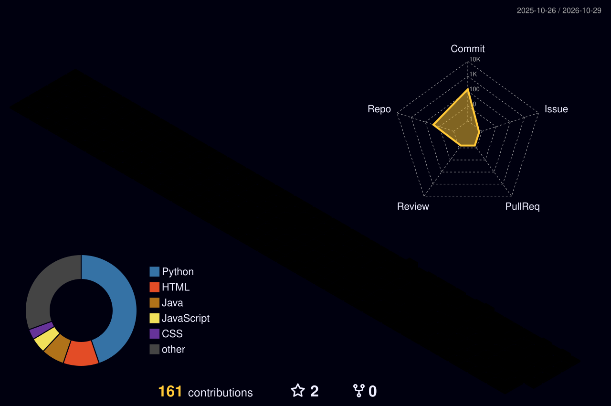

  
  
  
  

### Software Developer · Python · MERN · AI & Computer Vision

*I build practical applications, data-driven tools, and automation workflows that solve real problems.*

---

## About

- MCA student at **Lloyd Institute of Engineering & Technology** (2024–2026).
- Interested in Python development, full-stack web applications, AI, computer vision, and backend engineering.
- Hands-on project experience across web development, analytics dashboards, and workflow automation.
- Currently learning **Django, FastAPI, Docker, Node.js, and system design**.
- Open to suitable **internship and entry-level opportunities**.

## Tech Stack

**Languages**
 

**Frontend**
 

**Backend & APIs**
 

**Data & Databases**
 

**Tools**
 

## Featured Projects

<table>
<tr>
<td width="50%" valign="top">

### AI Surveillance System
Computer-vision project exploring person and motion detection, OCR, and surveillance workflows.

**Tech:** Python · OpenCV · YOLOv8 · OCR

[View repository](https://github.com/NaveenSharmaDev/AI-Surveillance-System)

</td>
<td width="50%" valign="top">

### AI Powered Job Portal
Recruitment platform concept with role-based access, resume upload, and a full-stack application architecture.

**Tech:** MongoDB · Express · React · Node.js

[View repository](https://github.com/NaveenSharmaDev/jobportal-yt-main)

</td>
</tr>
<tr>
<td width="50%" valign="top">

### Travel Buddy Robot
UiPath automation concept for flight-booking workflows, web automation, and data handling.

**Tech:** UiPath · RPA · Excel

[View repository](https://github.com/NaveenSharmaDev/uipath-project)

</td>
<td width="50%" valign="top">

### Voice Assistant
Python-based assistant for voice commands, web searches, opening websites, and everyday desktop tasks.

**Tech:** Python · Speech Recognition · Text-to-Speech

[View repository](https://github.com/NaveenSharmaDev/Voice-Assistant-Python)

</td>
</tr>
<tr>
<td width="50%" valign="top">

### Interactive 3D Portfolio
Personal portfolio showcasing projects, technical interests, and developer profile.

**Tech:** HTML · CSS · JavaScript

[View portfolio repository](https://github.com/NaveenSharmaDev/3d-portfolio) · [Live portfolio](https://naveensharmadev.github.io/3d-portfolio/)

</td>
<td width="50%" valign="top">

### Data Analytics & Dashboards
Projects involving SQL analysis, data-quality checks, customer analytics, and interactive dashboards.

**Tech:** Python · Pandas · SQL · Streamlit · Power BI

[Explore repositories](https://github.com/NaveenSharmaDev?tab=repositories)

</td>
</tr>
</table>

## GitHub Activity

 

## 3D Contribution Calendar

The 3D contribution artwork is generated daily by GitHub Actions. It appears here after the workflow has run successfully for the first time.

  <picture>
    <source media="(prefers-color-scheme: dark)" srcset="./profile-3d-contrib/profile-night-rainbow.svg"/>
    <source media="(prefers-color-scheme: light)" srcset="./profile-3d-contrib/profile-green-animate.svg"/>
    
  </picture>

## Contribution Snake

  <picture>
    <source media="(prefers-color-scheme: dark)" srcset="./output/github-snake-dark.svg"/>
    <source media="(prefers-color-scheme: light)" srcset="./output/github-snake.svg"/>
    
  </picture>

## Education & Certifications

- **Master of Computer Applications (MCA)** — Lloyd Institute of Engineering & Technology, 2024–2026
- **Bachelor of Computer Applications (BCA)** — Magadh University, 2020–2023
- AICTE Front-End Web Development Internship
- Google Vertex AI Prompt Design Certification

## Connect

I'm interested in connecting with developers, collaborating on practical projects, and exploring entry-level opportunities.

<a href="mailto:naveensharma.mca26@gmail.com">Email</a> ·
<a href="https://www.linkedin.com/in/naveen5212">LinkedIn</a> ·
<a href="https://github.com/NaveenSharmaDev">GitHub</a> ·
<a href="https://naveensharmadev.github.io/3d-portfolio/">Portfolio</a>

  

Always learning · Always building · Always improving

